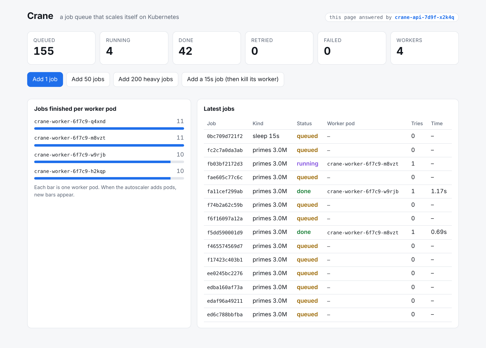
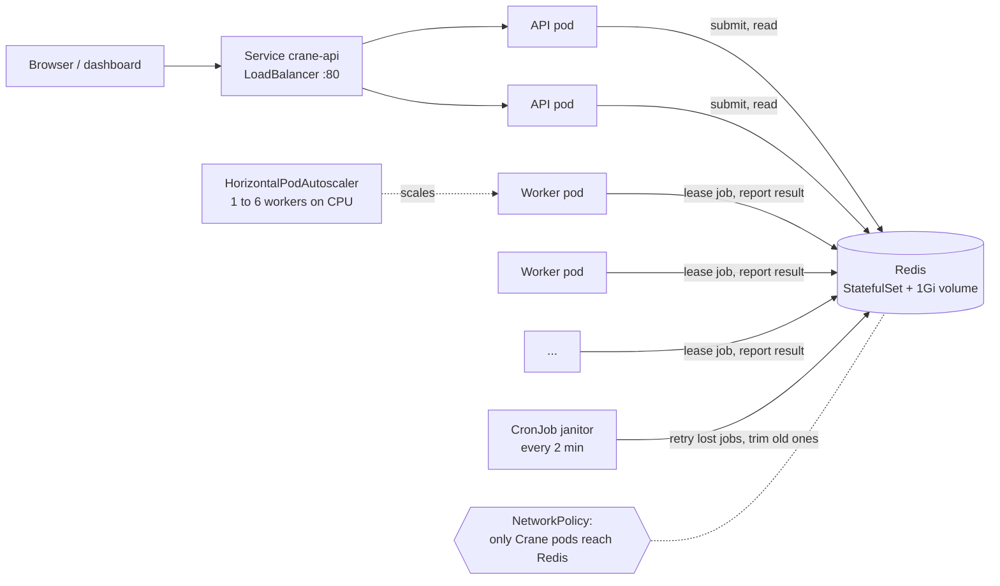

# Crane

**A job queue that scales itself on Kubernetes.** You send it jobs, worker
pods pick them up, and when the queue gets busy Kubernetes adds more workers
on its own. If a worker pod is killed in the middle of a job, the job isn't
lost. Another worker runs it again.




I built this to put into practice what I learned in **Learning Kubernetes**
(LinkedIn Learning, Kim Schlesinger). Every chapter of the course shows up
somewhere below.

## How it fits together



- **API** (FastAPI, 2 replicas): takes jobs and serves the dashboard. Every
  response says which pod answered, so you can see the LoadBalancer at work.
- **Workers** (1 to 6 replicas): lease a job from Redis, run it, report back.
- **Redis** (StatefulSet): holds the queue on a persistent volume.
- **Janitor** (CronJob): the safety net that retries lost jobs and cleans up.

## The one idea that makes it reliable: leases

A worker never just takes a job. It **leases** it for 20 seconds.

- If the worker finishes, it reports the result and the lease ends.
- If the worker's pod is killed, the lease runs out, and the job goes back in
  the queue for another worker.
- If a slow worker reports *after* its lease ran out and someone else took
  over, its result is ignored, so a job is never counted twice.
- After 3 failed attempts, the job is marked failed instead of looping forever.

Each of these steps is a small Lua script that Redis runs as one atomic
operation, so two workers can never grab the same job. The tests check all of
this with a fake clock, so they run in under a second.

## Run it on minikube

You need Docker Desktop, minikube and kubectl. In Git Bash (Windows) or any
terminal, from this folder:

```bash
minikube start --cni=calico   # calico makes the NetworkPolicy actually work
./scripts/up.sh               # build the image, deploy everything, wait until ready
minikube service crane-api -n crane   # open the dashboard
```

Then try the demos:

| Script | What you'll see |
|---|---|
| `./scripts/check.sh` | A BusyBox pod tests the app from inside the cluster, shows the Service spreading requests across both API pods, and confirms it *can't* reach Redis. Then events, logs, a janitor run, limits, and live CPU use |
| `./scripts/load.sh` | 300 heavy jobs go in, worker CPU climbs past the 70% target, and the autoscaler goes from 1 worker to as many as 6. A minute after the queue empties, it scales back down |
| `./scripts/chaos.sh` | Test 1: a worker is stopped normally mid-job, and it finishes the job before exiting. Test 2: a worker is force-killed mid-job, and the job comes back and finishes on another pod |
| `./scripts/down.sh` | Deletes everything (add `--cluster` to delete minikube too) |

Without Kubernetes: `docker compose up --build --scale worker=3`, then open
http://localhost:8080.

## Course topics → where they are

| Course chapter | In Crane |
|---|---|
| **Containers and cloud native** | One small image for every role (`Dockerfile`), running as a non-root user. The command picks the role: `api`, `worker` or `janitor` |
| **Setting up minikube** | `minikube image build` puts the image straight into the cluster, so no registry is needed. `minikube addons enable metrics-server` feeds the autoscaler |
| **YAML and namespaces** | Everything lives in the `crane` namespace, with one numbered file per part and comments explaining each choice |
| **Deploy an application** | `03-api.yaml`: a Deployment with 2 replicas and a rolling update that never drops below 2 ready pods |
| **Pod health and event logs** | Readiness and liveness probes on every long-running pod, and `check.sh` prints recent events |
| **Check the app with BusyBox** | `k8s/tools/busybox-check.yaml` calls the API through its Service from inside the cluster |
| **View application logs** | `check.sh` shows API, worker and janitor logs, including a janitor run started by hand from the CronJob |
| **LoadBalancer** | `crane-api` is `type: LoadBalancer`, and the dashboard shows which pod served each request |
| **Requests and limits** | Every container has both. The worker's CPU *request* is what the autoscaler measures against |
| **Tear down** | `down.sh` deletes the namespace, which removes everything in it |
| **Control plane and nodes** | The scheduler places pods by their requests. The controller manager replaces a killed pod (`chaos.sh`). The HPA controller adds workers (`load.sh`). The Downward API tells each pod its own name and node |
| **Ways to manage pods** | A Deployment (API, workers), a StatefulSet (Redis), a CronJob (janitor), a HorizontalPodAutoscaler and a PodDisruptionBudget |
| **Stateful workloads** | Redis is a StatefulSet with a volume and append-only mode, so queued jobs survive a Redis restart |
| **Security** | The namespace enforces Pod Security `restricted`. Every pod runs as non-root with a read-only filesystem, all Linux capabilities dropped, no privilege escalation, and no service-account token. The Redis password is a random Secret, never in Git, and a NetworkPolicy lets only Crane's pods reach Redis |

## Design choices worth explaining

- **Readiness and liveness check different things.** Readiness pings Redis,
  so a pod that can't reach it stops getting traffic. Liveness only checks the
  process. If liveness pinged Redis too, one Redis restart would make
  Kubernetes restart every healthy pod at once.
- **Workers have no port, so liveness uses a heartbeat file.** Each loop the
  worker touches `/tmp/heartbeat`, and the probe (`python -m crane probe`)
  fails if the file is older than 30 seconds, which catches a stuck worker.
- **Graceful shutdown.** On SIGTERM (scale-down, rolling update) a worker
  finishes its current job, then exits. `terminationGracePeriodSeconds: 30` is
  longer than the longest job (15 seconds).
- **The worker Deployment doesn't set `replicas`.** The autoscaler owns that
  number, so re-applying the file never undoes its decision.
- **Scale up fast, scale down slowly.** Up to 2 workers are added every 15
  seconds, but the autoscaler waits a quiet minute before removing any, so the
  worker count doesn't bounce up and down.

## Tests

```bash
pip install -e ".[dev]"
pytest -q        # 22 tests: queue, worker, API, probes
```

The tests cover jobs running oldest first, two workers never getting the same
job, a lost worker's job being retried, a late result being ignored, failing
after the maximum attempts, graceful shutdown, the heartbeat probe, and the
readiness/liveness split. CI also checks the Kubernetes files with
`kubeconform -strict`, lints the scripts with `shellcheck`, and smoke-tests
the image with a read-only filesystem, the same way Kubernetes runs it.

## Troubleshooting

| You see | Do this |
|---|---|
| `ErrImageNeverPull` / `ImagePullBackOff` | The image isn't in minikube. Run `minikube image build -t crane:1.0 .` |
| Autoscaler shows `<unknown>` CPU | metrics-server needs about a minute after `up.sh`. Check with `kubectl -n crane top pods` |
| `EXTERNAL-IP` stays `<pending>` | That's normal on minikube. Use `minikube service crane-api -n crane`, or run `minikube tunnel` |
| Redis pod stuck in `CrashLoopBackOff` | `kubectl -n crane logs redis-0`. If it's a volume permission error, run `./scripts/down.sh` and start minikube fresh |
| BusyBox says Redis is `REACHABLE` | NetworkPolicy isn't enforced. Restart minikube with `--cni=calico` |
